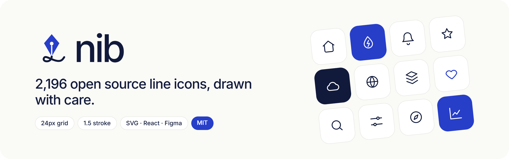
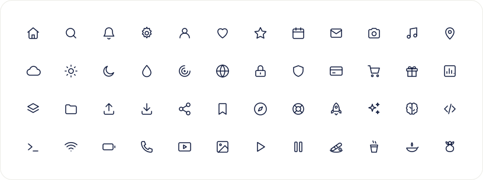
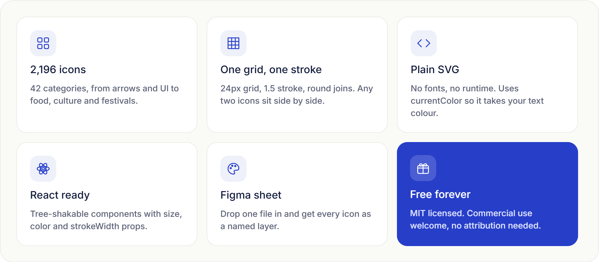

<div align="center">

<a href="https://mrigankad.github.io/nib-icons/">
  <picture>
    <source media="(prefers-color-scheme: dark)" srcset="assets/readme/banner-dark.png">
    
  </picture>
</a>

<p>
  <a href="https://mrigankad.github.io/nib-icons/"></a>
  <a href="https://www.npmjs.com/package/@mrigankad/nib-icons"></a>
  <a href="https://www.npmjs.com/package/@mrigankad/nib-icons-react"></a>
  
  <a href="LICENSE"></a>
</p>

<h3>
  <a href="https://mrigankad.github.io/nib-icons/">Browse icons</a>
  ·
  <a href="https://mrigankad.github.io/nib-icons/docs.html">Docs</a>
  ·
  <a href="https://mrigankad.github.io/nib-icons/#examples">Examples</a>
  ·
  <a href="dist/nib-icons.zip">Download</a>
</h3>

<br>

<picture>
  <source media="(prefers-color-scheme: dark)" srcset="assets/readme/preview-dark.svg">
  
</picture>

</div>

<br>

## Why Nib



## Quick start


### React

```bash
npm i @mrigankad/nib-icons-react
```

```jsx
import { NibHome, NibSearch, NibBell } from '@mrigankad/nib-icons-react';

export function Toolbar() {
  return (
    <nav>
      <NibHome />
      <NibSearch size={20} color="#1F3FD1" />
      <NibBell strokeWidth={1.75} aria-hidden="true" />
    </nav>
  );
}
```

Components are named `Nib` plus the icon name in PascalCase (`arrow-up` becomes `NibArrowUp`). They forward refs, accept every SVG prop, and are tree-shakable.

### SVG files

```bash
npm i @mrigankad/nib-icons
```

```js
import homeUrl from '@mrigankad/nib-icons/icons/home.svg';
```

Or skip the install and link straight from the CDN:

```html

```

### SVG sprite

Inline [`dist/sprite.svg`](dist/sprite.svg) once, then reference any icon by id:

```html
<svg width="24" height="24"><use href="#nib-home"/></svg>
```

### Figma and design tools

Drag [`dist/nib-figma.svg`](dist/nib-figma.svg) into Figma, Sketch or Penpot. Every icon arrives as its own named layer, grouped by category.

## Styling

```css
.icon { width: 20px; height: 20px; color: #1F3FD1; }
```

| Prop / attribute | Default | Notes |
|---|---|---|
| `size` (React) | `24` | Drawn for 24px. Crisp at 16, 20, 32 and 48. |
| `color` | `currentColor` | Never set `fill`, the icons are outlines. |
| `strokeWidth` | `1.5` | The house weight. Use `vector-effect: non-scaling-stroke` when scaling up. |

Decorative icons should get `aria-hidden="true"`. Icons that carry meaning on their own need `role="img"` and an `aria-label`.

## Categories

<details>
<summary>All 42 categories</summary>

<br>

| | | |
|---|---|---|
| Arrows · 60 | Chevrons & Carets · 30 | Interface Basics · 52 |
| Navigation & Layout · 50 | Actions & Editing · 59 | Text & Typography · 50 |
| Files & Folders · 60 | Communication · 60 | People & Users · 60 |
| Emotion & Faces · 40 | Media & Playback · 60 | Camera & Images · 40 |
| Design & Creative · 60 | Development & Code · 60 | Devices & Hardware · 60 |
| Connectivity & Network · 50 | Security & Privacy · 50 | Alerts & Status · 40 |
| Time & Calendar · 40 | Commerce & Shopping · 50 | Finance & Money · 55 |
| Business & Office · 60 | Charts & Data · 40 | Weather · 45 |
| Nature & Environment · 60 | Animals · 60 | Food & Drink · 80 |
| Travel & Places · 65 | Transport & Vehicles · 50 | Health & Medical · 60 |
| Sports & Fitness · 50 | Education & Learning · 50 | Home & Living · 50 |
| Tools & Construction · 50 | Industry & Energy · 50 | AI & Technology · 50 |
| Social · 50 | Gaming & Fun · 40 | Culture & Festivals · 50 |
| Fashion & Beauty · 50 | Shapes & Symbols · 50 | Accessibility & Settings · 50 |

</details>

## Design rules

| 24px grid | 2px live padding | 1.5 stroke | Round caps and joins |
|:-:|:-:|:-:|:-:|

Keep shapes inside the 20px live area, use one continuous stroke where you can, and simplify until the icon reads at 16px. Don't mix filled and outline styles, put text inside icons, or trace photos.

## Contributing

Want an icon that isn't here? [Open an issue](https://github.com/mrigankad/nib-icons/issues/new?labels=icon%20request&title=Icon%20request%3A%20) with the name and where you'd use it.

To build from source:

```bash
python scripts/build.py          # SVG files, sprite, zip, site data
python scripts/build_react.py    # React components
python scripts/build_extras.py   # Figma sheet and README images
```

## License

[MIT](LICENSE). Use Nib in anything you like.
